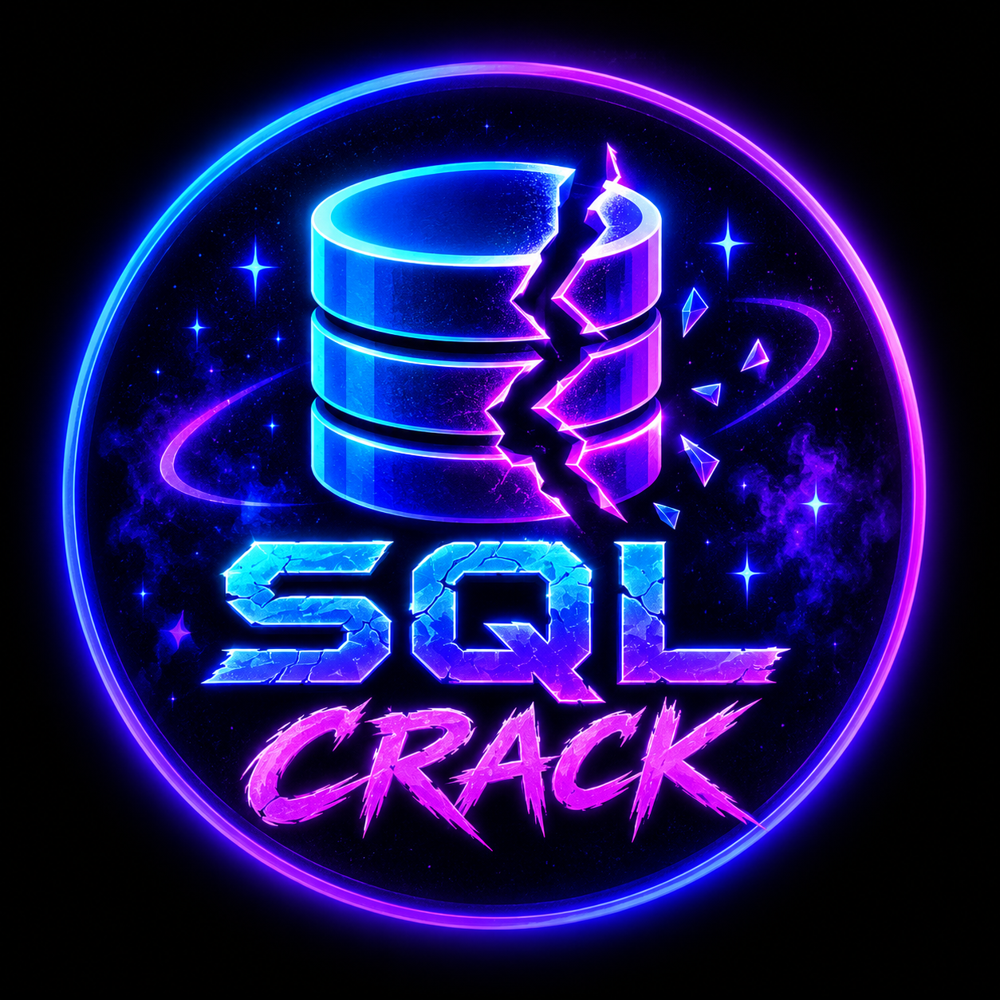

# 💜 SQL Crack — v1.0.0

<p align="center">
  
</p>

<p align="center">
  <strong>Neon hacker arayüzlü, eğitim amaçlı SQL güvenlik testi simülatörü.</strong><br>
  25 özellik • Canlı terminal • Kalıcı günlükler • Sahte SQL dump • Windows CMD başlatıcısı
</p>

> [!IMPORTANT]
> **SQL Crack gerçek bir SQL saldırı aracı değildir.** Gerçek web sitelerine SQL enjeksiyonu uygulamaz, veritabanlarına bağlanmaz veya veri sızdırmaz. Testler tamamen **simülasyon** olarak çalışır; oluşturulan SQL dump dosyaları **sentetik (sahte) örnek veriler** içerir.

## ✨ Özellikler

| # | Özellik | # | Özellik |
|---|---|---|---|
| 1 | `.bat` ile tek tık başlatma | 14 | Uyarı sayacı |
| 2 | Python 3 kontrolü | 15 | Sunucu bağlantı durumu |
| 3 | Uygun portu otomatik bulma (8000–8010) | 16 | Kalıcı JSONL günlükler |
| 4 | Tarayıcıyı otomatik açma | 17 | Günlüklerde arama |
| 5 | Özel SQL Crack logosu | 18 | Olay seviyesi filtresi |
| 6 | Neon hacker tasarımı | 19 | Tarih filtresi |
| 7 | Mobil uyumlu arayüz | 20 | Günlük sayfalama |
| 8 | `v1.0.0` sürüm etiketi | 21 | JSON rapor indirme |
| 9 | 4 sahte demo hedefi | 22 | CSV rapor indirme |
| 10 | 6 simülasyon senaryosu | 23 | Sahte SQL dump üretme ve kaydetme |
| 11 | Yerel metin sınıflandırması | 24 | Dump listeleme, indirme ve silme |
| 12 | Canlı terminal ekranı | 25 | Günlük temizleme, kısayollar ve aktivite grafiği |
| 13 | Toplam olay sayacı | | |

## 🖥️ Kurulum ve çalıştırma

**Gereksinimler:** Windows ve **Python 3**. Ek Python paketi gerekmez.

1. Projeyi indirip ZIP arşivinden **tamamen çıkar**.
2. `SQL_Crack_Baslat.bat` dosyasına çift tıkla.
3. Açılan CMD penceresini açık bırak. Tarayıcı otomatik açılır.
4. Tarayıcı açılmazsa CMD penceresinde yazan `127.0.0.1` adresini aç (genellikle `http://127.0.0.1:8000`).
5. Sunucuyu kapatmak için CMD üzerinde **Ctrl+C** kullan.

> Python bulunamıyorsa [Python'un resmî sitesinden](https://www.python.org/downloads/) Python 3 yükleyip kurulumda **Add Python to PATH** seçeneğini etkinleştir.

## 🧪 Nasıl kullanılır?

**Test Laboratuvarı** bölümünden bir sahte hedef ve simülasyon senaryosu seç. Testi çalıştırdıktan sonra sonuçları canlı terminalde ve olay günlüklerinde görüntüleyebilirsin. Arama, filtreleme ve rapor dışa aktarma özellikleriyle önceki sonuçları inceleyebilirsin.

**Sahte SQL dump** senaryosunu seçtiğinde uygulama eğitim için örnek `.sql` dosyası üretir. Bu dosyalar uygulamanın `data/dumps/` klasörüne kaydedilir; arayüz üzerinden görüntülenebilir, indirilebilir veya silinebilir.

## 📁 Proje yapısı

```text
SQL_Crack_v1.0.0/
├── SQL_Crack_Baslat.bat
├── server.py
├── index.html
├── style.css
├── app.js
├── assets/
│   └── sql-crack-logo.png
└── data/
    ├── events.jsonl
    └── dumps/
```

| Dosya / klasör | Açıklama |
|---|---|
| `SQL_Crack_Baslat.bat` | Windows CMD başlatıcısı |
| `server.py` | Yerel web sunucusu ve demo API |
| `index.html`, `style.css`, `app.js` | Web arayüzü |
| `assets/` | Uygulama logosu |
| `data/events.jsonl` | Kalıcı simülasyon olay kayıtları |
| `data/dumps/` | Sentetik SQL örnekleri |

## 🔒 Güvenlik ve gizlilik

- Sunucu yalnızca **`127.0.0.1`** adresine bağlanır; dış ağ erişimine açılmaz.
- Gerçek SQL sorguları ve SQL enjeksiyon saldırıları çalıştırılmaz.
- Dump dosyaları gerçek sistemlerden alınan veriler değil, **örnek eğitim verileridir**.
- Teste girilen özel metnin içeriği kaydedilmez; yalnızca uzunluğu işlenir.
- Çalışma kayıtları bilgisayarındaki `data/` klasöründe saklanır.

## 🛠️ Sorun giderme

**CMD hemen kapanıyor:** Projeyi ZIP içinden değil, çıkardığın klasörden çalıştır. `server.py` ile `.bat` dosyasının aynı klasörde olduğundan emin ol.

**Python bulunamadı:** Komut İstemi'nde `py -3 --version` veya `python --version` komutunu dene.

**Tarayıcı açılmıyor:** CMD ekranında gösterilen adresi elle aç. `8000` doluysa sunucu `8001`–`8010` aralığından uygun bir port kullanabilir.

**Loglar kaydedilmiyor:** Proje klasöründe yazma iznin olduğundan emin ol.

## 👨‍💻 Yapımcı

**TarikPro43391**  
**Sürüm:** `v1.0.0`

---

<p align="center">💜 <strong>SQL Crack</strong> — Eğitim ve arayüz simülasyonu için geliştirilmiştir.</p>
