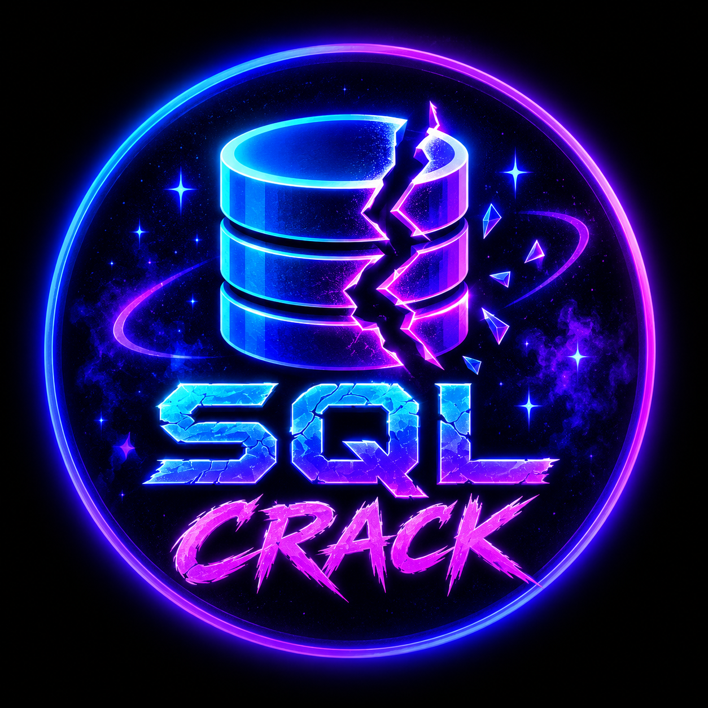

# 💜 SQL Crack — v1.0.5 (Beta)

<p align="center">
  
</p>

<p align="center">
  <strong>Neon hacker arayüzlü, eğitim amaçlı SQL güvenlik testi simülatörü.</strong><br>
  32 özellik • Canlı terminal • Kalıcı günlükler • Sahte SQL dump • Windows CMD başlatıcısı
</p>

> [!IMPORTANT]
> **SQL Crack gerçek bir SQL saldırı aracı değildir.** Gerçek web sitelerine SQL enjeksiyonu uygulamaz, veritabanlarına bağlanmaz veya veri sızdırmaz. SQL senaryoları **simülasyon** olarak çalışır; ayrı izinli HTTP kontrolü yalnızca zararsız GET istekleri gönderir. SQL dump dosyaları **sentetik (sahte) örnek veriler** içerir.

## 🚀 v1.0.5 (Beta) güncellemesi

**Yayın kanalı:** Beta. Uygulamada, API yanıtlarında, kaynak kodda ve belgelerde sürüm etiketi `v1.0.5 (Beta)` olarak kullanılır. Ana klasörün adı da `SQL Crack v1.0.5 (Beta)` olarak güncellenmiştir.


- **İzinli HTTP kontrolü:** URL kapsamı `scope.json` dosyasında açıkça belirtilen hedeflerde zararsız GET kontrolleri.
- **Rastgele parametreler:** Her kontrolde yeni, zararsız parametre isimleri ve örnek değerleri.
- **Hız sınırı:** Bir çalıştırmada en fazla 3, dakikada toplam en fazla 6 istek.
- **Güvenlik:** Yanıt içeriği toplanmaz; yönlendirme takip edilmez, SQL payload kullanılmaz.
- **Sunucu Sağlık Monitörü (yeni):** Sunucu çalışma süresi, yerel yanıt sayısı, son yanıtların ortalama gecikmesi ve HTTP 5xx sayacı.
- **Gelişmiş Test Raporları (yeni):** Son 24 saat ile önceki 24 saatin karşılaştırılması; uyarılar, kontrol başarı yüzdesi, ortalama yanıt süresi ve en sık kullanılan senaryolar.
- **Akıllı Güvenlik Kontrolü (yeni):** İzinli hedef sayısı, son bir saatte engellenen denemeler, kalan dakikalık istek kotası ve art arda başarısız kontroller.
- **Korunan özellikler:** Matrix CMD introsu, kalıcı loglar, örnek dump, raporlar ve neon arayüz.

Ayrıntılar için [`YENILIKLER_v1.0.5 (Beta).md`](<YENILIKLER_v1.0.5 (Beta).md>) dosyasına bakın.

## ✨ Özellikler

| # | Özellik | # | Özellik |
|---|---|---|---|
| 1 | `.bat` ile tek tık başlatma | 14 | Uyarı sayacı |
| 2 | Python 3 kontrolü | 15 | Sunucu bağlantı durumu |
| 3 | Uygun portu otomatik bulma (8000–8010) | 16 | Kalıcı JSONL günlükler |
| 4 | Tarayıcıyı otomatik açma | 17 | Günlüklerde arama |
| 5 | Özel SQL Crack logosu | 18 | Olay seviyesi filtresi |
| 6 | Neon hacker tasarımı | 19 | Tarih filtresi |
| 7 | Mobil uyumlu arayüz | 20 | Günlük sayfalama |
| 8 | `v1.0.5 (Beta)` sürüm etiketi | 21 | JSON rapor indirme |
| 9 | 4 sahte demo hedefi | 22 | CSV rapor indirme |
| 10 | 6 simülasyon senaryosu | 23 | Sahte SQL dump üretme ve kaydetme |
| 11 | Yerel metin sınıflandırması | 24 | Dump listeleme, indirme ve silme |
| 12 | Canlı terminal ekranı | 25 | Günlük temizleme, kısayollar ve aktivite grafiği |
| 13 | Toplam olay sayacı | 26 | İzinli HTTP kontrolü |
| 27 | Rastgele zararsız parametreler | 28 | Kesin URL izin listesi |
| 29 | Hız ve istek limiti | 30 | Sunucu sağlık monitörü |
| 31 | 24 saatlik karşılaştırmalı test raporları | 32 | Akıllı güvenlik ve kota uyarıları |

## 🖥️ Kurulum ve çalıştırma

**Gereksinimler:** Windows ve **Python 3.9 veya üzeri**. Ek Python paketi gerekmez.

1. Projeyi indirip ZIP arşivinden **tamamen çıkar**. Klasör adı **`SQL Crack v1.0.5 (Beta)`** olur.
2. **`Start.py`** dosyasını `py -3 Start.py` ile çalıştır veya `SQL Crack Start.bat` dosyasına çift tıkla; BAT da `Start.py` çalıştırır.
3. Açılan CMD penceresini açık bırak. Tarayıcı otomatik açılır.
4. Tarayıcı açılmazsa CMD penceresinde yazan `127.0.0.1` adresini aç (genellikle `http://127.0.0.1:8000`).
5. Sunucuyu kapatmak için CMD üzerinde **Ctrl+C** kullan.

> Python bulunamıyorsa [Python'un resmî sitesinden](https://www.python.org/downloads/) Python 3 yükleyip kurulumda **Add Python to PATH** seçeneğini etkinleştir.

## 🧪 Nasıl kullanılır?

**Test Laboratuvarı** bölümünden bir sahte hedef ve simülasyon senaryosu seç. Testi çalıştırdıktan sonra sonuçları canlı terminalde ve olay günlüklerinde görüntüleyebilirsin. Arama, filtreleme ve rapor dışa aktarma özellikleriyle önceki sonuçları inceleyebilirsin.

**Sahte SQL dump** senaryosunu seçtiğinde uygulama eğitim için örnek `.sql` dosyası üretir. Bu dosyalar uygulamanın `data/dumps/` klasörüne kaydedilir; arayüz üzerinden görüntülenebilir, indirilebilir veya silinebilir.

## 📁 Proje yapısı

```text
SQL Crack v1.0.5 (Beta)/
├── Start.py                # Matrix / yazma animasyonu + baslatma
├── SQL Crack Start.bat
├── server.py
├── safe_probes.py
├── insights.py             # Yerel monitör, rapor ve güvenlik özetleri
├── scope.json
├── index.html
├── style.css
├── app.js
├── assets/
│   └── sql-crack-logo.png
└── data/
    ├── events.jsonl
    └── dumps/
```

| Dosya / klasör | Açıklama |
|---|---|
| `Start.py` | Havalı animasyon ve sunucuyu başlatma |
| `SQL Crack Start.bat` | Windows için Start.py başlatma kısayolu |
| `server.py` | Yerel web sunucusu ve demo API |
| `safe_probes.py` | İzinli ve sınırlı HTTP kontrolü |
| `insights.py` | Karşılaştırmalı rapor ve güvenlik uyarılarının salt okunur hesaplamaları |
| `scope.json` | Açıkça onaylanan tam URL listesi |
| `index.html`, `style.css`, `app.js` | Web arayüzü |
| `assets/` | Uygulama logosu |
| `data/events.jsonl` | Kalıcı simülasyon olay kayıtları |
| `data/dumps/` | Sentetik SQL örnekleri |

## 🔒 Güvenlik ve gizlilik

- Sunucu yalnızca **`127.0.0.1`** adresine bağlanır; dış ağ erişimine açılmaz.
- Gerçek SQL sorguları ve SQL enjeksiyon saldırıları çalıştırılmaz.
- Dump dosyaları gerçek sistemlerden alınan veriler değil, **örnek eğitim verileridir**.
- Teste girilen özel metnin içeriği kaydedilmez; yalnızca uzunluğu işlenir.
- Çalışma kayıtları bilgisayarındaki `data/` klasöründe saklanır.

## 🛠️ Sorun giderme

**CMD hemen kapanıyor:** Projeyi ZIP içinden değil, çıkardığın klasörden çalıştır. `server.py` ile `.bat` dosyasının aynı klasörde olduğundan emin ol.

**Python bulunamadı:** Komut İstemi'nde `py -3 --version` veya `python --version` komutunu dene.

**Tarayıcı açılmıyor:** CMD ekranında gösterilen adresi elle aç. `8000` doluysa sunucu `8001`–`8010` aralığından uygun bir port kullanabilir.

**Loglar kaydedilmiyor:** Proje klasöründe yazma iznin olduğundan emin ol.

## 👨‍💻 Yapımcı

**TarikPro43391**  
**Sürüm:** `v1.0.5 (Beta)`

---

<p align="center">💜 <strong>SQL Crack</strong> — Eğitim ve arayüz simülasyonu için geliştirilmiştir.</p>

## 🎬 Açılış animasyonu

`Start.py` başlatıldığında CMD içinde önce Matrix karakterleri akar; ardından ASCII SQL CRACK başlığı ve komut benzeri **tamamen sahte** durum satırları **harf harf** belirir. Açılış animasyonunun bitmesinin ardından yerel web paneli açılır.

- `py -3 Start.py --fast` — animasyon gecikmelerini atlar.
- `py -3 Start.py --no-animation` — Matrix efekti olmadan başlar.
- `py -3 Start.py --intro-only` — sadece tanıtımı oynatır.

Windows terminali ANSI renklerini desteklemiyorsa yazı temelli animasyon kullanılır. Bu ekran gerçek güvenlik kontrolleri yapıldığı anlamına gelmez.

## 🛡️ v1.0.5 (Beta): izinli ve zararsız HTTP kontrolleri

Yeni bölüm, onaylanan tam URL’ye **1–3 adet rastgele ve zararsız GET parametresi** gönderir. Gerçek SQL saldırısı, payload üretimi, WAF atlatma, veri sızdırma veya SQL açıklığı doğrulaması yapmaz. Yanıt gövdesini okumaz, yönlendirmeleri takip etmez; yalnızca HTTP durum kodunu ve yanıt süresini raporlar. İstekler arasında en az 0,8 saniye vardır; toplamda dakikada en fazla 6 kontrol yapılabilir.

**Kullanım:** Web arayüzünde *İzinli HTTP Kontrolü* bölümünü aç. Varsayılan örnek adres kendi sunucunun `/api/health` URL’sidir. Dışarıdaki **sana ait ve izinli HTTPS** uç noktalarını kullanmak için `scope.json` dosyasında `approved_urls` listesine **tam URL** ekle. Örneğin `https://kendi-test-ortamin.example/health` (örnek adres). Sonra izin onayını işaretle ve en fazla 3 kontrol başlat. Harici hedeflerde port 443 gereklidir.

```json
{
  "approved_urls": [
    "https://kendi-test-ortamin.example/health"
  ]
}
```

Uygulama **izinsiz hedeflere karşı saldırı aracı değildir**. Sadece kapsamı tanımlanmış uygulamaların hafif HTTP davranışını gözlemlemek içindir.

## 🆕 v1.0.5 (Beta) içinde eklenen 3 özellik

### 1. Sunucu Sağlık Monitörü
Web panelinde **Sağlık Monitörü** bölümünde yerel Python sunucusunun açık kaldığı süreyi, toplam yanıt sayısını, son 200 HTTP yanıtının ortalama süresini ve 5xx hata sayısını görebilirsin. Bu ölçüm yeni dış hedef isteği üretmez.

### 2. Gelişmiş Test Raporları
**Gelişmiş Raporlar** son 24 saatin verilerini önceki 24 saatle karşılaştırır. Olay sayısı, uyarı sayısı, izinli GET kontrolü başarı oranı ve ortalama yanıt gecikmesi gösterilir. Eski sürümden kalan HTTP loglarında detay metrikleri bulunmayabilir.

### 3. Akıllı Güvenlik Kontrolü
**Akıllı Güvenlik** paneli `scope.json` bütünlüğünü, izinli URL sayısını, son 60 dakikada kapsam/limit nedeniyle engellenen denemeleri, kalan isteği ve arka arkaya başarısız kontrolleri takip eder. Ret kayıtları yalnızca sunucu açıkken bellekte tutulur; gönderilen hedef URL'leri ve özel test girdileri bu sayaca yazılmaz.

> Bu üç yeni özellik herhangi bir güvenlik açığını kanıtlamaz ve yeni saldırı/SQL enjeksiyonu işlevi içermez. Sürüm numarası değişmemiştir: **v1.0.5 (Beta)**.

**Otomatik testler:** Proje klasöründe `python -m unittest discover -s tests -v`.

## 🛠️ v1.0.5 (Beta) bakım düzeltmeleri (sürüm değişmedi)

- Bozuk/eski olay günlükleri rapor ve güvenlik ekranını durdurmaz.
- Dump silme, log temizleme ve log yazma izin hataları anlaşılır mesajlar döndürür.
- Log kaydı başarısız olursa yeni üretilen sahte dump dosyası temizlenir.
- Başlatıcıdaki `--no-animation` seçeneği bekleme animasyonlarını da devre dışı bırakır.
- Web paneli bağlantı zaman aşımını bildirir; çakışan yenilemeler güncel bilgiyi ezmez.
- Sürüm hâlâ `v1.0.5 (Beta)`; 32 mevcut özellik korunur.

**Testleri çalıştırmak için:** `python -m unittest discover -s tests -v`

## ✅ v1.0.5 (Beta) sürüm tutarlılığı ve ek onarımlar

- Uygulamanın HTML, JavaScript, Python, CMD başlatıcısı ve belgelerindeki sürüm etiketi **v1.0.5 (Beta)** olarak gösterilir.
- HTTP sunucusu sürüm kimliği ve zararsız kontrol isteği User-Agent değeri de aynı etiketi kullanır.
- Günlük dosyasına erişim hatalarında API artık bağlantıyı aniden kesmek yerine açıklayıcı JSON hatası döndürür.
- Arayüz dosyası okuma hataları uygun HTTP 500 mesajıyla bildirilir.
- Başlatıcı adı **SQL Crack Start.bat**, proje klasörü **SQL Crack v1.0.5 (Beta)** olarak korunur.

